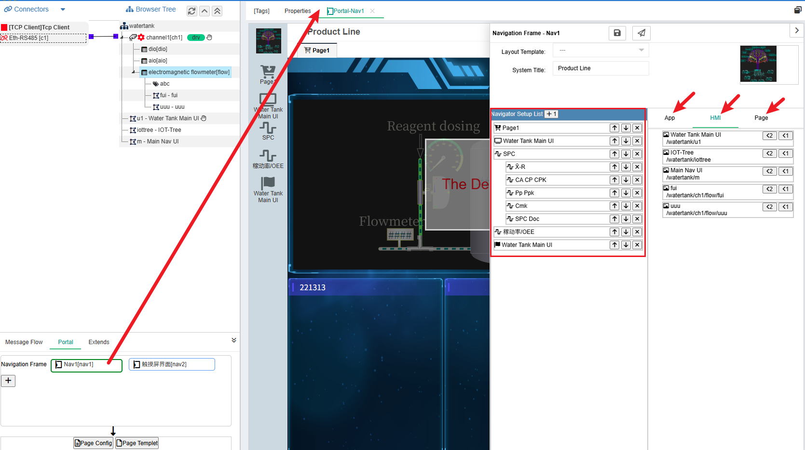
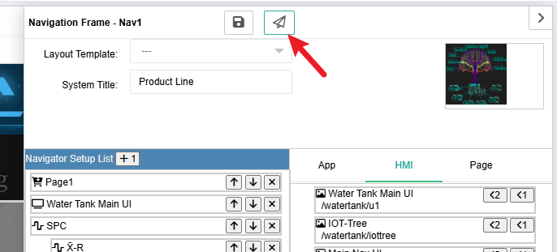
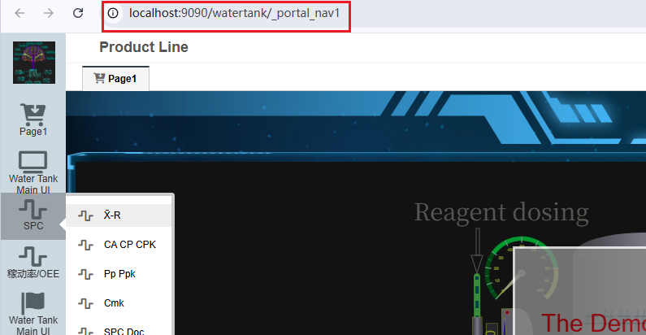

应用门户
==

应用门户在IOT-Tree项目中，定义了一种二级导航界面定制功能。你可以选定一种界面模板，然后通过1级和2级的导航内容设置，配置生成现场需要的一个应用（功能导航）UI界面。

一个项目可以定义多个导航界面，其中一个是缺省导航界面。

每个导航界面可以设置导航模板（风格），导航界面标题，应用图标和1级2级导航内容。

其中，二级导航内容可以利用当前应用提供的url入口，hmi组态画面和定制页面三部分内容。

查看页面按钮：

可以打开运行过程中实际使用的界面

